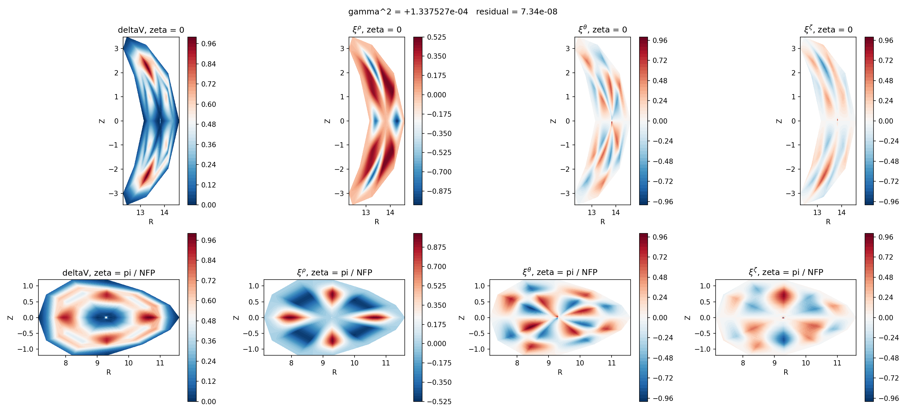

# agnimhd

agnimhd solves the ideal MHD energy principle for a tokamak or stellarator
equilibrium. It returns the most unstable mode, both its squared growth rate γ²
and its eigenfunction, the plasma displacement ξ, and the derivative of γ²
with respect to every parameter of the equilibrium. It is the code of the AGNI
paper (R. Gaur et al., [arXiv:2608.01750](https://arxiv.org/abs/2608.01750),
2026), cited on these pages as the paper. The package is under active
development, and its interface may change between versions.

## What you get

- **The growth rate.** γ² of the most unstable mode for every toroidal mode
  number. A tokamak is solved one n at a time, and a stellarator one family of
  toroidal modes at a time on one field period
  ([Stellarators](stellarators.md), [Tokamaks](tokamaks.md)).
- **The eigenfunction.** The displacement ξ = (ξ<sup>ρ</sup>, ξ<sup>θ</sup>,
  ξ<sup>ζ</sup>) on every node, the perturbed magnetic field δB = ∇×(ξ×B) and
  the perturbed speed |δV|. `agnimhd.plotting` draws ξ and |δV| in the
  (R, Z) plane, as below, and the mode amplitude as a radial profile
  ([Plotting the mode](stellarators.md#plotting-the-mode)).
- **The gradient.** The derivative of γ² with respect to the parameters of the
  equilibrium, from the eigenvector of the solve (Hellmann-Feynman, equation
  (60) of the paper) and JAX. In DESC it is an objective, `AgniStability`, that
  adds stability to an optimization ([DESC coupling](desc.md)).
- **A check on every answer.** The residual of the eigenpair tells whether the
  mode is converged ([Checking a result](options.md#checking-a-result)).
- **CPU, GPU or TPU.** The default solver runs on all three. A matrix-free
  solver handles grids whose matrix does not fit in memory, and a dense solver
  splits the largest matrices over several GPUs
  ([Choosing options](options.md#eigensolver)).
- **Any equilibrium code.** DESC files are read directly, EFIT g-files through
  DESC, and other codes through a set of arrays ([Interface](interface.md)).



The most unstable mode of a quasi-helical stellarator, family 0 at 24×12×8.
The first column is |δV| and the others are the three components of ξ, at
ζ = 0 (top) and ζ = π/NFP (bottom).

## What it computes

A small displacement ξ of the plasma changes the potential energy by
δW<sub>p</sub> (equation (16) of the paper) and carries the kinetic energy
δK (equation (18)). The energy principle

```
δWₚ = −λ δK                                   (paper, equation (19))
```

is an eigenvalue problem for ξ and λ. agnimhd discretizes it on a
grid in PEST coordinates (ρ, θ, ζ) and finds the largest λ,
which is the squared growth rate γ² in units of (v<sub>A</sub>/a<sub>N</sub>)², with
v<sub>A</sub> the Alfvén speed and a<sub>N</sub> the minor radius. The code returns it as
`gamma2`.

**A positive γ² means the equilibrium is unstable.** A negative one means
the mode oscillates and the equilibrium is stable to it.

## A first run

agnimhd reads DESC equilibria directly.

```bash
pip install "desc-opt==0.17.3" agnimhd
agnimhd solve my_equilibrium.h5 --res 24,12,8
```

The second line evaluates the equilibrium on 24 radial, 12 poloidal and 8
toroidal nodes, prints γ² for each family of toroidal modes, and ends
with the verdict `UNSTABLE` or `stable`.

In Python the same solve also returns the eigenvector.

```python
import agnimhd

basis = agnimhd.Basis(24, 12, 8)
eq, diffmat = agnimhd.from_desc("my_equilibrium.h5", basis)
gamma2, v, residual = agnimhd.eigenpair(eq, diffmat)
```

`gamma2` is γ² of family 0, `v` the eigenvector, from which `agnimhd.plotting`
recovers ξ and draws it, and `residual` the check of the pair.

## Next steps

- [Installation](installation.md) covers GPUs and installing without DESC.
- The [Tutorial](notebooks/stability_of_an_equilibrium.ipynb) solves a
  stellarator step by step in about four minutes on one CPU core, without DESC.
- [Stellarators](stellarators.md) and [Tokamaks](tokamaks.md) show the solve
  for each kind of device.
- [Choosing options](options.md) explains the resolution, the eigensolver and
  the shift first, then the remaining settings.
- [DESC coupling](desc.md) uses γ² and its derivative as an objective in a
  DESC optimization.
- [Interface](interface.md) lists the arrays agnimhd needs from an equilibrium
  code other than DESC.
- [Theory](theory.md) follows the discretization and the eigensolvers equation
  by equation.

## Citing

R. Gaur, S. Patil, P. Gupta, D. Patch, T. Qian, *AGNI: A differentiable MHD
stability solver & optimizer for magnetic confinement fusion devices*,
[arXiv:2608.01750](https://arxiv.org/abs/2608.01750) (2026). The PDF of v3 is in
the repository at `docs/paper/agni_arxiv_2608.01750v3.pdf`. BibTeX is in the
README and `CITATION.cff`.
