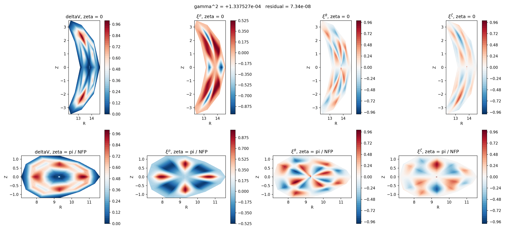

# Stellarators

A stellarator equilibrium repeats every field period, 2π/NFP in the
toroidal angle. agnimhd places its toroidal nodes on one field period and still
finds modes of every toroidal mode number, one family of them at a time.

## Solving a DESC equilibrium

```bash
agnimhd solve stellarator.h5 --res 24,12,8
```

evaluates the DESC equilibrium on 24 radial, 12 poloidal and 8 toroidal nodes
and solves every toroidal mode family. It prints γ² and the residual of
each family, the most unstable family, and the verdict `UNSTABLE` or `stable`.

In Python the equilibrium is evaluated once and each family is solved on it.

```python
import agnimhd

basis = agnimhd.Basis(24, 12, 8)
eq, _ = agnimhd.from_desc("stellarator.h5", basis)
for x in basis.families(eq.NFP):
    diffmat = basis.nodes_and_diffmat(eq.NFP, family=x)[1]
    gamma2, v, residual = agnimhd.eigenpair(eq, diffmat)
    print(x, float(gamma2), float(residual))
```

The equilibrium is unstable when any family has a positive γ². `v` is the
eigenvector and `residual` measures how well it is converged
([Checking a result](options.md#checking-a-result)).

## Toroidal mode families

Because the equilibrium repeats every field period, a mode with toroidal mode
number n couples only to n + NFP, n + 2·NFP and so on. The modes therefore
split into independent families, and family x holds n = x + k·NFP for every
integer k. Each family is solved on the one-period grid, with 1/NFP of the
unknowns of the full torus, and together the families have exactly the
eigenvalues of the full torus.

- Family NFP − x has the eigenvalues of family x, so `basis.families(NFP)`
  lists only x = 0 to ⌊NFP/2⌋.
- Families 0 and NFP/2 give real matrices. The others give complex Hermitian
  matrices, which take twice the memory.
- The equilibrium is the same for every family. Evaluate it once and take each
  family's derivative matrices from the basis, as above.

## Stellarator symmetry

Most stellarators are stellarator symmetric, unchanged under the reflection
(ρ, θ, ζ) → (ρ, −θ, −ζ). For families 0 and NFP/2 the
matrix then splits into an even and an odd block of about half the size each.
Solve both and take the larger γ².

```python
for parity in ("even", "odd"):
    config = agnimhd.AssemblyConfig(parity=parity)
    gamma2, v, residual = agnimhd.eigenpair(eq, diffmat, config)
```

The two blocks together take about a quarter of the time and memory of the full
matrix. An equilibrium that is not stellarator symmetric is refused.

## Plotting the mode

`agnimhd.plotting.plot_eigenfunction_cross_sections` draws the eigenvector in the
(R, Z) plane. It needs matplotlib (`pip install "agnimhd[plot]"`) and the R and
Z of the nodes, which `EquilibriumData` does not carry.
`tools/export_desc_example.py` writes them next to an export as
`<name>_RZ.npz`, and the example in `examples/data` has them.

```python
import json
from pathlib import Path

import numpy as np
import agnimhd
from agnimhd.assemble import matfree_operator
from agnimhd.plotting import plot_eigenfunction_cross_sections

DATA = Path("examples/data")
eq = agnimhd.EquilibriumData.load(DATA / "qh_modprof_24x12x8.npz")
meta = json.loads((DATA / "qh_modprof_24x12x8.json").read_text())
basis = agnimhd.Basis(*eq.resolution, radial="lobatto",
                      automorphism=meta["automorphism"])
diffmat = basis.nodes_and_diffmat(eq.NFP)[1]
gamma2, v, residual = agnimhd.eigenpair(eq, diffmat)

geom = np.load(DATA / "qh_modprof_24x12x8_RZ.npz")
op = matfree_operator(eq, diffmat)
fig, axes = plot_eigenfunction_cross_sections(
    eq, op, np.asarray(v), gamma2, geom["R"], geom["Z"])
```



The top row is the plane ζ = 0 and the bottom row ζ = π/NFP, half a field
period further. The first column is the perturbed speed |δV| (equation (58)
of the paper, the quantity of its Fig. 4), and the other three are the
displacement components ξ<sup>ρ</sup>, ξ<sup>θ</sup> and ξ<sup>ζ</sup>. Each panel
is scaled to a largest magnitude of 1, so the figure shows the shape of the mode
and not its amplitude. This is family 0 of the modified LBD QH case at 24×12×8,
γ² = 1.3375e-4, and the contours are coarse because the grid is.

## Larger cases

The default eigensolver forms the whole matrix, which stops fitting in memory as
the resolution grows. [Choosing options](options.md#eigensolver) describes the
matrix-free solver `"jd"` and the solver for several GPUs, `"dense_mg"`.

The stellarator benchmark of the paper (section 5.1) is a quasi-helically
symmetric (QH) equilibrium. The [Tutorial](notebooks/stability_of_an_equilibrium.ipynb)
solves it at low resolution without DESC.
